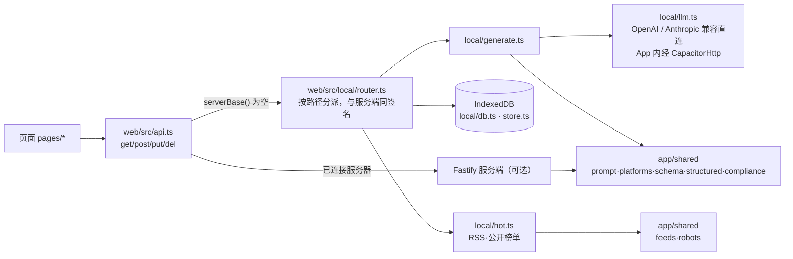

# 架构说明

## 总体结构

```mermaid
flowchart LR
  subgraph 客户端（同一份 React 代码）
    PWA[网页 PWA] --- CAP[Capacitor：Android / iOS] --- ELE[Electron：Windows / macOS]
  end
  ELE -- 内置启动 --> API
  PWA -- HTTPS/HTTP --> API
  CAP -- 服务地址 --> API
  subgraph 后端 Node + Fastify
    API[REST 接口\nCSP/口令/统一错误] --> Q[任务队列\n并发·重试·退避·超时]
    Q --> SRC[信息源适配器\nRSS·公开网页·公众号·X·抖音]
    Q --> HOT[热榜采集\nrobots·限速·缓存]
    Q --> HUB[模型能力层 ModelHub\nllm·vision·image·tts·asr·video·embedding·ocr]
    API --> LIB[内容库\n去重·标签]
    API --> CNT[选题·改写流水线·审核]
    API --> HO[发布交接\n复制+创作中心·公众号草稿箱·X 意图链接]
    API --> AG[系统文件 agent/\nsoul·方法·USER·APPROVAL·skills·memory]
    API --> IMP[版本·回滚·A/B 评测·改进日志]
    API --> PL[插件管理（按终端）]
  end
  SRC & HOT --> DB[(SQLite)]
  LIB & CNT & IMP --> DB
  API --> V[(加密密钥库\nAES-256-GCM)]
  HUB --> P1[国内：百炼·DeepSeek·智谱·方舟·MiniMax·Kimi]
  HUB --> P2[境外（经代理）：OpenAI·Anthropic·Gemini·ElevenLabs]
  HUB --> P3[本地：Ollama·ComfyUI]
  HO -.用户本人点击发布.-> PF[各平台官方 App / 创作中心]
```

## 关键设计

| 主题 | 做法 |
|---|---|
| 硬边界 | `server/src/boundaries.ts` 常量；信息源类型、skill 工具、插件能力均走白名单；所有模型请求最前拼接硬边界 |
| 模型能力层 | `server/src/models/`：8 个能力统一接口；`providers.ts` 提供方目录；`adapters.ts` 协议适配（openai/anthropic/dashscope/zhipu/minimax/elevenlabs/comfyui）；`hub.ts` 路由、备用、成本 |
| 任务队列 | `queue.ts`：并发上限 3、指数退避（1s 起，上限 60s）、超时；“未配置/robots 禁止”为不可重试错误；任务写入 tasks 表 |
| 采集合规 | `sources/web.ts`：robots 解析（最长匹配），5xx 视为禁止；`HostRateLimiter` 同域名默认 ≥5 秒；拒绝内网地址 |
| 系统文件 | `modules/agentfiles.ts`：编辑即生成版本，回滚生成新记录，历史不删；每日日志与主题记忆；APPROVAL 只能更严格 |
| 发布交接 | `modules/handoff.ts`：只做草稿箱推送、复制、深链接；没有任何发布接口调用。知乎：复制后打开专栏写作页或用户提供的问题页 |
| 登录保持 | `desktop/main.cjs`：每平台持久分区 `persist:creator-<平台>`；跳转/每 60 秒/退出前 `cookies.flushStore()`；启动不清理；`creator-state.json` 记录上次地址；“退出登录/清除登录”是唯一的 `clearStorageData` 调用；状态只按域名 Cookie 数量判断 |
| 本地应用 | `modules/localapps.ts`（`local_apps` 表、校验、导入导出）；客户端 `web/src/native.ts`：Android/iOS 原生插件 `LocalApps`（`mobile/native/`，由 `mobile/scripts/apply-native.mjs` 注入工程），桌面经 IPC 用 `shell.openPath`/`openExternal`；只启动与分享，不做界面自动化 |
| 安全 | CSP、X-Frame-Options、访问口令（定时比较）、密钥不回显、日志脱敏、前端包密钥扫描、npm audit |
| 离线 | Service Worker：外壳缓存 + 接口 GET 网络优先回落缓存；前端显示“离线” |

## 0.6.0：本机模式与共用模块



| 主题 | 做法 |
|---|---|
| 模式判断 | `api.ts`：`serverBase()` 为空 = 本机模式，请求交给 `local/router.ts`；填了服务器地址且测试连接成功 = 服务端模式。两种模式页面代码相同。 |
| 共用模块（A14） | `app/shared/src/`：`prompt.ts`（稳定前缀组装）、`platforms.ts`（平台字数规则、默认 Schema）、`schema.ts` + `structured.ts`（JSON Schema 校验与一次修复）、`compliance.ts`、`feeds.ts`（RSS/Atom 解析）、`robots.ts`、`errors.ts`（白话错误分类）、`skill.ts`、`json.ts`。服务端 `server/src/modules/prompt.ts`、`schemas.ts`、`compliance.ts`、`models/schema.ts`、`models/structured.ts`、`sources/rss.ts`、`sources/web.ts` 改为引用它；本机 `local/generate.ts`、`local/hot.ts` 同样引用。 |
| 模型直连 | `local/llm.ts`：OpenAI 兼容 `/chat/completions` 与 Anthropic 兼容 `/messages`；Capacitor 开启 `plugins.CapacitorHttp.enabled`，原生层发请求，不受 WebView 跨域限制；网页版跨域失败归类为“跨域被拒”并提示。 |
| 本机数据 | IndexedDB 集合：drafts、topics、apps、metrics、logs，另有 kv 存设置与服务商配置；Key，界面只显示末四位，不写日志，备份默认不含。 |
| 平台数据 | `web/src/data/platforms.ts`：7 个平台与官方 App 包名 / Scheme 为前端静态数据（`data/providers.ts` 服务商预设，`data/assistants.ts` 写作助手默认指令），添加软件与平台页不再依赖接口。 |
| 安全区 | `statusbar.ts` 调 `@capacitor/status-bar`（不覆盖内容、按主题切图标颜色）；CSS 用 `env(safe-area-inset-*)`（变量 `--sa-top` 等，测试可注入）。 |
| 服务端（可选） | 配音、配图、合成视频、多设备共用需要服务端；本机模式下这些入口显示“需要连接服务器”。 |

## 数据表

sources、runs、items、topics、drafts、draft_edits、handoffs、metrics、versions、tasks、usage、hot_items、hot_runs、local_apps、settings。
